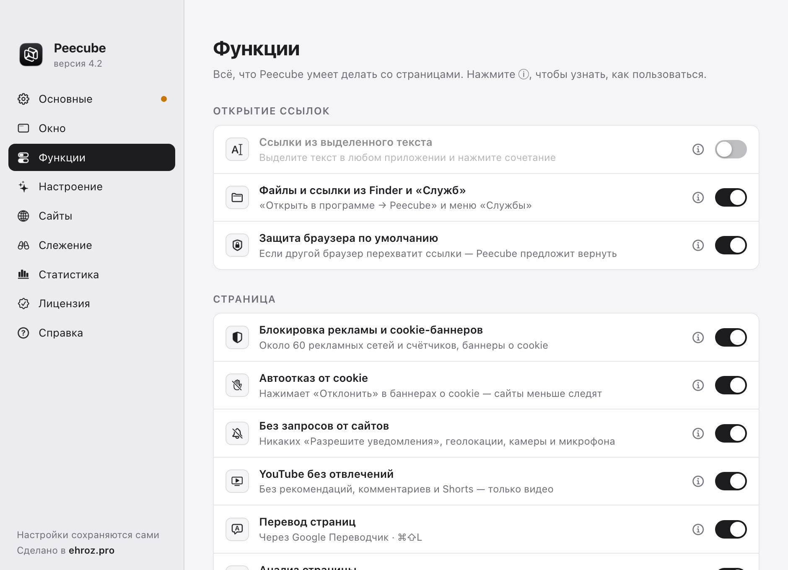
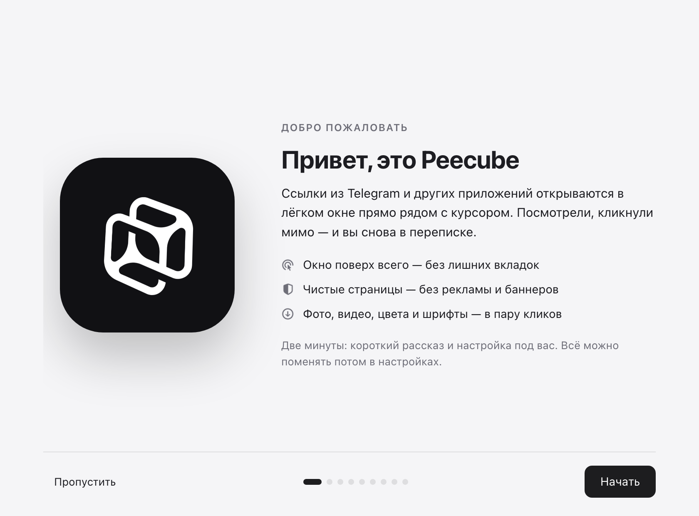
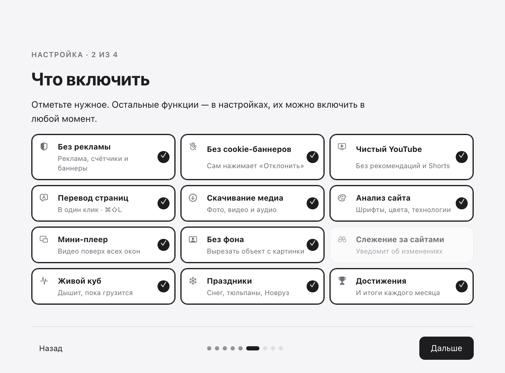

<h1 align="center">Peecube</h1>

Ссылки из Telegram — в окне поверх всего. Зажми <kbd>⌥</kbd>, нажми правой кнопкой по ссылке — посмотрел, кликнул мимо, и ты снова в переписке.

  <a href="https://github.com/ehroz1/peecube-releases/releases/latest/download/Peecube.dmg"><b>⬇︎ Скачать для Mac</b></a>
  &nbsp;·&nbsp;
  <a href="https://github.com/ehroz1/peecube-releases/releases/latest/download/Peecube-Chrome.zip">Для Chrome</a>
  &nbsp;·&nbsp;
  <a href="https://github.com/ehroz1/peecube-releases/releases/latest/download/Peecube-Firefox.zip">Для Firefox</a>
  &nbsp;·&nbsp;
  <a href="https://ehroz.pro">ehroz.pro</a>

  
  
  

## Как это работает

1. Peecube становится браузером по умолчанию и живёт в строке меню — значок-куб.
2. Зажмите клавишу и нажмите правой кнопкой по ссылке в Telegram или любом другом приложении.
3. Ссылка открывается в лёгком окне прямо рядом с курсором. Esc, клик мимо или смахивание вниз — окно закрылось, вы там же, где были.

| Действие | Что происходит |
|---|---|
| <kbd>⌥</kbd> + правый клик | ссылка — во всплывающем окне (сочетание меняется в настройках) |
| обычный клик | ссылка открывается как раньше — в вашем браузере |
| <kbd>⌥⌘L</kbd> | все ссылки из выделенного текста в любом приложении |
| <kbd>⌘↩</kbd> | перенести страницу в обычный браузер |
| <kbd>⌘⇧P</kbd> | закрепить окно поверх всего |
| зажать <kbd>⌘</kbd> | шпаргалка по всем сочетаниям |

## Что умеет

**Окно**: раскрывается из места клика, запоминает размер для каждого сайта, вкладки, восстановление закрытого (<kbd>⌘⇧T</kbd>), превью ссылок с <kbd>⌥</kbd>, полупрозрачность, мини-плеер для видео поверх всех окон.

**Чистые страницы**: без рекламы и счётчиков (около 60 сетей), автоматический отказ от cookie, никаких «Разрешите уведомления», YouTube без рекомендаций, комментариев и Shorts, «Скрыть этот элемент» для надоедливых блоков.

**Для дизайнера**: анализ страницы — шрифты, цвета (клик — скопировать), технологии сайта и вес картинок; скриншот всей страницы одной картинкой; копирование любой картинки, даже если сайт запрещает; вырезание фона силами macOS; кадр из видео в исходном качестве.

**Скачивание**: все фото, видео и аудио страницы с понятными именами файлов, WebP и AVIF — сразу в PNG или JPG, видео с YouTube, Instagram и VK через yt-dlp.

**Ещё**: перевод страниц, QR-коды на картинках, слежение за сайтами с уведомлениями и таймлапсом изменений, правила для сайтов, главное окно-браузер с избранным и историей, импорт из Firefox, статистика, достижения, итоги месяца и живой куб в строке меню.

Каждая функция включается и выключается отдельно.

## Установка

1. Скачайте **[Peecube.dmg](https://github.com/ehroz1/peecube-releases/releases/latest/download/Peecube.dmg)** и откройте его.
2. Перетащите **Peecube** в папку «Программы».
3. Первый запуск: правый клик по Peecube → «Открыть» → «Открыть».
   Если macOS всё равно не пускает: «Системные настройки → Конфиденциальность и безопасность → Всё равно открыть»
   или в Терминале `xattr -dr com.apple.quarantine /Applications/Peecube.app`.

Работает на macOS 13 и новее, Apple Silicon и Intel. Для скачивания видео с YouTube и Instagram пригодится бесплатный [yt-dlp](https://github.com/yt-dlp/yt-dlp) (`brew install yt-dlp ffmpeg`).

## Знакомство и настройка

При первом запуске Peecube показывает короткую презентацию и за пару минут настраивает себя под вас: сочетание клавиш, нужные функции, три разрешения (браузер по умолчанию, универсальный доступ, уведомления), обновления и автозапуск. Пройти снова — «Настройки → Справка → Знакомство».

<table>
  <tr>
    <td></td>
    <td></td>
  </tr>
</table>

## Настройки не теряются

Копия всех настроек, истории, избранного и ключа хранится **отдельно от программы** — в `~/Library/Application Support/Peecube` и в скрытой папке `~/.peecube`. Если удалить Peecube и поставить заново, всё вернётся само.

Перенести на другой Mac: «Настройки → Справка → Сохранить в файл…», на новом компьютере — «Загрузить…».

## Обновления

Peecube обновляется сам: каждые 6 часов и после пробуждения Mac он проверяет этот репозиторий. Новая версия скачивается, сверяется по подписи автора и контрольной сумме и ставится, когда окна Peecube закрыты; при ошибке возвращается прежняя версия. Обновить сразу — пункт **«Обновить Peecube до X»** в меню значка. Список изменений — в [релизах](https://github.com/ehroz1/peecube-releases/releases).

## Надёжность

- <kbd>⌘Q</kbd> в окне Peecube закрывает окна, но Peecube продолжает ловить ссылки. Выйти совсем — <kbd>⌥⌘Q</kbd> или «Выйти» в меню значка.
- Если Peecube закрылся не по команде (сбой, принудительное завершение), он сам запустится снова в течение полуминуты.
- Перехват сочетания с правым кликом проверяется каждые 5 секунд и чинится сам, если система его отключила.

## Расширения для браузеров

Те же возможности внутри браузера: зажмите <kbd>⌥</kbd> и нажмите правой кнопкой по ссылке. Один ключ работает и в приложении, и в расширениях.

**Chrome, Edge, Brave, Arc** (Chrome 137+): скачайте **[Peecube-Chrome.zip](https://github.com/ehroz1/peecube-releases/releases/latest/download/Peecube-Chrome.zip)**, распакуйте в постоянную папку, откройте `chrome://extensions`, включите «Режим разработчика» → «Загрузить распакованное расширение» → выберите папку.

**Firefox** (142+): скачайте **[Peecube-Firefox.zip](https://github.com/ehroz1/peecube-releases/releases/latest/download/Peecube-Firefox.zip)**, откройте `about:debugging#/runtime/this-firefox` → «Загрузить временное дополнение…» → выберите архив. Firefox держит неподписанные дополнения до перезапуска; постоянная версия появится после проверки в каталоге Mozilla.

<table>
  <tr>
    <td></td>
    <td></td>
  </tr>
</table>

## Цена

14 дней — бесплатно и без ограничений. Дальше — один ключ навсегда: разовая покупка, все будущие обновления включены. Ключ вводится в «Настройки → Лицензия». Когда пробный период закончится, ссылки по-прежнему будут открываться — в вашем обычном браузере.

## Конфиденциальность

Peecube работает на вашем компьютере. История, статистика и настройки не покидают Mac, ключ проверяется без интернета. В сеть уходят только запросы самих страниц, проверка обновлений на GitHub и — если вы им пользуетесь — перевод через Google Переводчик.

---

Сделано в <a href="https://ehroz.pro"><b>ehroz.pro</b></a> · Здесь только готовые сборки, исходный код закрыт.

