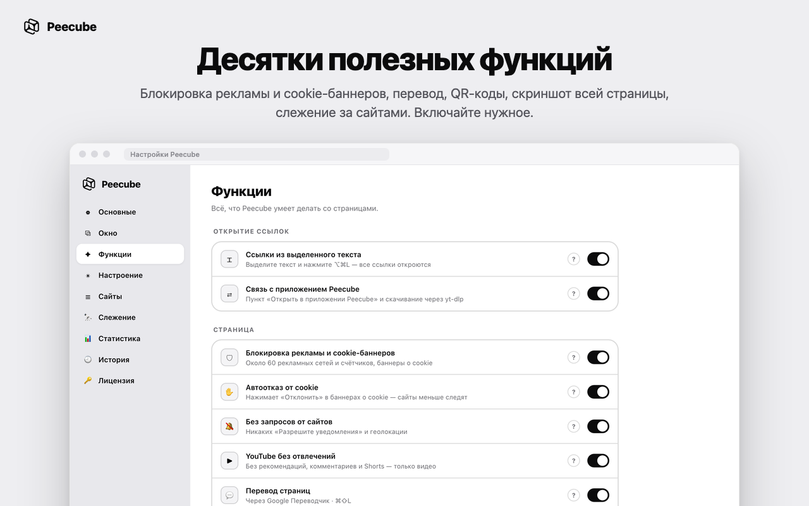

<h1 align="center">Peecube</h1>

  Ссылки из Telegram и других приложений — в аккуратном окне поверх всего. 
  Посмотрели, кликнули мимо — и вы там же, где были.

  <a href="https://github.com/ehroz1/peecube-releases/releases/latest/download/Peecube.dmg"><b>⬇︎ Скачать для Mac</b></a>
  &nbsp;·&nbsp;
  <a href="https://github.com/ehroz1/peecube-releases/releases/latest/download/Peecube-Firefox.zip">Расширение для Firefox</a>
  &nbsp;·&nbsp;
  <a href="https://github.com/ehroz1/peecube-releases/releases/latest/download/Peecube-Chrome.zip">Расширение для Chrome</a>

  
  
  

## Зачем это

Вам весь день присылают ссылки — макеты, референсы, статьи. Каждая открывает браузер, плодит вкладки
и выдёргивает из переписки. Peecube становится браузером по умолчанию и открывает ссылку в лёгком окне
прямо рядом с курсором. Клик мимо окна — оно закрывается, вы снова в чате. Нужна страница надолго —
`⌘↩` переносит её в ваш обычный браузер.

## Что умеет

|  |  |
|---|---|
| 🪟 **Окно поверх всего** | Раскрывается из места клика, запоминает размер для каждого сайта, закрепляется `⌘⇧P`, закрывается смахиванием вниз |
| 🛡 **Чистые страницы** | Без рекламы и счётчиков, автоматический отказ от cookie, никаких «Разрешите уведомления», YouTube без рекомендаций и Shorts |
| 🖼 **Фото и видео** | Скачивание любых картинок, видео и аудио с понятными именами файлов, WebP/AVIF → PNG/JPG, YouTube и Instagram через yt-dlp |
| ✂️ **Копирование** | Любая картинка — даже если сайт запрещает правый клик, вырезание фона силами macOS, кадр из видео в исходном разрешении |
| 🎨 **Анализ страницы** | Шрифты, цвета (клик — скопировать), технологии сайта и вес картинок — то, что нужно дизайнеру |
| 📸 **Скриншот всей страницы** | Один длинный PNG в «Загрузки» |
| 🌐 **Перевод и QR-коды** | Перевод страницы в один клик, ссылка из QR-кода на картинке открывается сама |
| 🔭 **Слежение за сайтами** | Регулярные снимки нужных страниц и уведомление, когда на них что-то изменилось |
| ⌨️ **Ссылки отовсюду** | Выделите текст в любом приложении — откроются все ссылки из него; файлы из Finder и меню «Службы» |
| 🧊 **Немного радости** | Живой куб в строке меню, праздничные заставки, достижения и итоги месяца |

Каждая функция включается и выключается отдельно в настройках.

<table>
  <tr>
    <td></td>
    <td></td>
  </tr>
  <tr>
    <td></td>
    <td></td>
  </tr>
</table>

## Установка на Mac

1. Скачайте **[Peecube.dmg](https://github.com/ehroz1/peecube-releases/releases/latest/download/Peecube.dmg)** и откройте его.
2. Перетащите **Peecube** в папку «Программы».
3. Первый запуск: правый клик по Peecube.app → «Открыть» → «Открыть».
   Если macOS всё равно не пускает: «Системные настройки → Конфиденциальность и безопасность → Всё равно открыть».
4. Peecube проведёт по короткой настройке и предложит стать браузером по умолчанию — так он начнёт ловить ссылки из Telegram.

Нужна macOS 13 или новее, Apple Silicon или Intel.
Для скачивания видео с YouTube и Instagram пригодится бесплатный [yt-dlp](https://github.com/yt-dlp/yt-dlp) (`brew install yt-dlp ffmpeg`).

## Расширения для браузеров

Те же возможности внутри браузера: зажмите `⌥` и нажмите правой кнопкой по ссылке. Один ключ работает и в приложении, и в расширениях.

**Chrome, Edge, Brave, Arc** (Chrome 137+)
1. Скачайте **[Peecube-Chrome.zip](https://github.com/ehroz1/peecube-releases/releases/latest/download/Peecube-Chrome.zip)** и распакуйте в постоянную папку.
2. Откройте `chrome://extensions` и включите «Режим разработчика».
3. «Загрузить распакованное расширение» → выберите распакованную папку.

**Firefox** (142+)
1. Скачайте **[Peecube-Firefox.zip](https://github.com/ehroz1/peecube-releases/releases/latest/download/Peecube-Firefox.zip)**.
2. Откройте `about:debugging#/runtime/this-firefox` → «Загрузить временное дополнение…» → выберите скачанный архив.

   Firefox держит неподписанные дополнения до перезапуска. Версия для постоянной установки появится после проверки в каталоге Mozilla.

## Цена

14 дней — бесплатно и без ограничений. Дальше — один ключ навсегда: разовая покупка, все будущие обновления включены.
Ключ вводится в «Настройки → Лицензия». Когда пробный период закончится, ссылки по-прежнему будут открываться — в вашем обычном браузере.

## Обновления

Peecube обновляется сам: проверяет этот репозиторий и ставит новую версию, когда его окна закрыты.
Каждое обновление подписано, приложение проверяет подпись и контрольную сумму перед установкой.
Список изменений — в [релизах](https://github.com/ehroz1/peecube-releases/releases).

## Конфиденциальность

Peecube работает на вашем компьютере. История, статистика и настройки не покидают Mac, ключ проверяется без интернета.
В сеть уходят только запросы самих страниц, проверка обновлений на GitHub и — если вы ими пользуетесь — перевод через Google Переводчик.

---

Здесь только готовые сборки. Исходный код закрыт.
